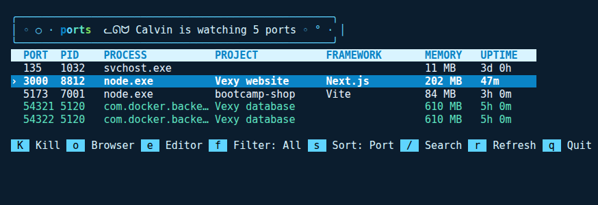

# ports

See which programs are using which ports on your Windows computer, and stop the ones you don't need. A Vexy admin tool.



Vexy's own ports are labelled, so you can tell at a glance whether the Vexy website (3000) and the Vexy database (54321 to 54324) are running.

## Commands

| Command | What it does |
| --- | --- |
| `ports` | Live dashboard that refreshes every 3 seconds |
| `ports list` | Table of every listening port with its program, project, framework, memory and uptime |
| `ports check 3000` | Everything about the program on port 3000: PID, full command, project folder, framework, memory, uptime |
| `ports kill 3000` | Stops the program on port 3000 after asking. Add `--force` if it won't close, `--yes` to skip the question |
| `ports open 3000` | Opens http://localhost:3000 in your browser |

`ports` never stops parts of Windows itself, like System or svchost.exe.

### Dashboard keys

| Key | Does |
| --- | --- |
| ↑ ↓ | Pick a port |
| K | Stop the picked program (asks first; F force-stops) |
| o | Open it in your browser |
| e | Open its project folder in VS Code (or File Explorer) |
| f | Filter: all ports, dev servers only, or Vexy only |
| s | Sort by port, memory or uptime |
| / | Search; Esc clears |
| r | Refresh now |
| q | Quit |

## Install

You need Windows and [Node.js](https://nodejs.org) 22.18 or newer.

In PowerShell:

```powershell
git clone https://github.com/Mingyu521/ports
cd ports
npm install
npm link
```

`npm install` also builds the command. `npm link` installs `ports` globally, so it works from any folder. Open a new PowerShell window and run:

```powershell
ports list
ports --help
```

To remove it later, run `npm unlink -g ports`.

## How it works

`ports` runs commands that come with Windows: `netstat -ano` for the listening TCP ports and their process IDs, `tasklist` for the program names, and PowerShell's `Get-CimInstance Win32_Process` for each program's command line, memory and start time. A program listening on the same port through both IPv4 and IPv6 shows up once. The project and framework come from the nearest `package.json` above the paths in the command line.

- `src/scan.ts` finds the ports (the scanner).
- `src/details.ts` and `src/project.ts` add command, memory, uptime, project and framework.
- `src/table.ts` draws the `list` table and the `check` view.
- `src/actions.ts` stops programs and opens the browser or editor.
- `src/dashboard.tsx` is the live dashboard, built with Ink.
- `src/labels.ts` knows Vexy's ports.
- `src/cli.ts` is the command itself.

## Develop

```powershell
npm run build      # compile TypeScript into dist/
npm test           # run the tests (build first)
npm run typecheck
```

The tests include live checks that start a throwaway server, make sure `ports list` finds it once, then `ports check` and `ports kill` it. They run on Windows only; GitHub runs them on every pull request.
